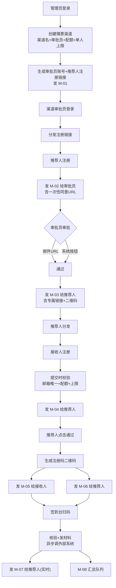

# KCon2026 赠票系统 需求规格说明书
| 项 | 内容 |
|---|---|
| 文档编号 | KCON-SRS-001 |
| 版本 | **V3.1（生产级）** |
| 状态 | 已评审通过 |
| 编制 | 产品架构组 |
| 评审 | PR-01（含 V3.1 变更复审） |
| 适用会议 | KCon 2026（主题：奕智） |
| 系统邮箱 | kcon@knownsec.com |

> **v1 系统边界（2026-10-26）**：本系统只负责会前赠票资格分发（渠道 → 推荐人 → 接收人）与审批、邮件出箱；
> 现场签到、抽奖、兑奖由 KconLucky 系统负责。`/checkin` 页面与 `/api/admin/staff` 不再对现场开放，
> 签到相关代码仅保留，详见 `specs/011-gift-ticket-handoff`。管理员账户改为「管理员账户管理」CRUD，
> 不再写死邮箱白名单。
---
## 1. 文档说明
### 1.1 编写目的
本文档定义 KCon2026 赠票系统的完整需求，作为设计、开发、测试、验收的唯一依据。V3.1 在 V3.0 基础上**新增"更换渠道审批员"功能需求**（响应客户质询与 BUG-006），并完成全链路变更传播。
### 1.2 规模基线（硬约束）
| 维度 | 上限 | 设计余量 | 说明 |
|---|---|---|---|
| 渠道数 | **≤ 20** | 30 | 单库单表，无需分片 |
| 总赠票数 | **≤ 500** | 800 | 含所有渠道配额之和 |
| 推荐人数 | ≤ 400 | 600 | 按每渠道 20 人估算 |
| 赠票接收人 | ≤ 500 | 800 | 与总赠票数一致 |
| 签到并发 | **10 次/秒** | 20 次/秒 | 会议当天峰值 |
| 注册页并发 | 50 用户 | 100 用户 | 500 票 / 10 分钟估算 |
| 邮件发送量 | ≤ 2000 封/场 | 3000 | 含审批、通知、汇总 |
> **设计结论**：该规模下单机 SQLite + 单进程 Python 服务完全够用，无需分布式组件。
### 1.3 术语
| 术语 | 定义 |
|---|---|
| 渠道 | 赠票分发组织单元 |
| 渠道审批员 | 渠道负责人，审批本渠道推荐人；**每渠道 1 个，可由管理员更换** |
| 推荐人 | 拥有专属赠票链接、可分发赠票的人 |
| 赠票接收人 | 通过推荐人链接注册的参会人 |
| 注册码 | 注册成功后生成的二维码，现场签到凭证 |
| 一次性令牌 | 审批用的单次有效令牌，7 天过期 |
| 配额 | 渠道可发放赠票总数上限 |
| 单人上限 | 单个推荐人可发放赠票上限 |
---
## 2. 角色与权限
### 2.1 角色清单
| 角色 | 数量约束 | 登录方式 | 核心职责 |
|---|---|---|---|
| 系统管理员 | **≤ 3 个**（配置文件 MD5 写死） | 邮箱 + 验证码 | 建渠道、看全局、代审批、**更换审批员**、建签到账号 |
| 渠道审批员 | 每渠道 1 个 | 邮箱 + 验证码 | 审批推荐人、看本渠道数据 |
| 签到工作人员 | 不限 | 账号 + 密码 | 扫码核验、发材料 |
| 推荐人 | ≤ 400 | 免登录 | 发链接、审批赠票 |
| 赠票接收人 | ≤ 500 | 免登录 | 填信息、拿二维码 |
### 2.2 权限矩阵
| 功能 | 管理员 | 审批员 | 签到员 | 推荐人 | 接收人 |
|---|:---:|:---:|:---:|:---:|:---:|
| 建/停用/删除渠道 | ✅ | ❌ | ❌ | ❌ | ❌ |
| **更换渠道审批员** | ✅ | ❌ | ❌ | ❌ | ❌ |
| 查看全局数据 | ✅ | ❌ | ❌ | ❌ | ❌ |
| 查看本渠道数据 | ✅ | ✅ | ❌ | ❌ | ❌ |
| 审批推荐人 | ✅ 代审 | ✅ | ❌ | ❌ | ❌ |
| 审批赠票 | ✅ 代审 | ❌ | ❌ | ✅ | ❌ |
| 签到核验 | ✅ 应急 | ❌ | ✅ | ❌ | ❌ |
| 查看统计 | ✅ 全量 | ✅ 本渠道 | ❌ | ❌ | ❌ |
| 建签到账号 | ✅ | ❌ | ❌ | ❌ | ❌ |
### 2.3 数据可见性（接口层强制校验）
1. 管理员：全部数据
2. 审批员：仅本渠道，跨渠道返回 403
3. 签到员：仅姓名/单位/注册码/状态，**不可见手机邮箱**
4. 推荐人：仅本人邀请的接收人
5. 接收人：仅本人信息
---
## 3. 业务流程
### 3.1 主流程

### 3.2 关键流程规格
#### 3.2.1 管理员登录
| 步骤 | 规则 |
|---|---|
| 邮箱校验 | MD5 比对白名单，启用管理员 ≤ 3 个 |
| 验证码 | 6 位数字，10 分钟有效，60 秒重发间隔，单日 ≤ 20 次 |
| 错误锁定 | 连续错 5 次锁定 30 分钟 |
| 会话 | 2 小时 |
#### 3.2.2 创建与管理赠票渠道
**输入项：**
| 字段 | 必填 | 校验 |
|---|:---:|---|
| 渠道名称 | ✅ | 2～50 字符，全局唯一 |
| 渠道审批员姓名 | ✅ | 2～20 字符 |
| 渠道审批员邮箱 | ✅ | 邮箱格式，全局唯一（一个邮箱只担任一个渠道审批员） |
| 赠票配额 | ✅ | 1～500（受总赠票 500 约束） |
| 推荐人单人上限 | ✅ | 1～100，默认 20 |
| 渠道备注 | ❌ | 200 字符 |
**系统行为**：创建渠道 → 创建审批员账号 → 生成 16 位随机渠道码 → 发 M-01。
**【V3.1 新增】更换渠道审批员规则：**
| 项 | 规则 |
|---|---|
| 触发 | 管理员对本渠道指定新审批员（姓名+邮箱） |
| 前置校验 | 渠道存在且为启用状态；新邮箱未被其他渠道占用；新邮箱不是当前审批员 |
| 执行顺序 | ①停用原审批员 → ②新建审批员 → ③作废本渠道全部未使用的推荐人审批令牌 → ④为每个待审批推荐人重新签发令牌并发 M-02 给新审批员 → ⑤发 M-01 通知新审批员 |
| 安全要求 | 换人后原审批员的旧审批链接必须失效，防止离职人员凭旧邮件继续审批 |
| 审计 | 记录操作人、原/新审批员、作废旧令牌数、重签数 |
**删除规则**：默认软删除（停用），链接立即失效，历史数据保留；物理删除仅限无关联数据。
#### 3.2.3 推荐人注册与审批
| 字段 | 必填 | 校验 |
|---|:---:|---|
| 姓名 | ✅ | 2～20 字符 |
| 公司 | ✅ | 2～50 字符 |
| 部门 | ✅ | 2～30 字符 |
| 手机 | ✅ | 中国大陆手机号 |
| 邮箱 | ✅ | 邮箱格式，全局唯一 |
**审批双通道互斥**：邮件一次性链接与系统按钮，任一处理后另一方式立即失效。
**被拒重申**：7 天后可用同一邮箱重新申请（复用原记录）。
#### 3.2.4 赠票接收人注册
| 字段 | 必填 | 校验 |
|---|:---:|---|
| 姓名 | ✅ | 2～20 字符 |
| 单位 | ✅ | 2～50 字符 |
| 手机号 | ❌ | 填写时校验格式 |
| 邮箱 | ✅ | 邮箱格式，**全局唯一** |
**提交时 5 项校验**（全部在提交时拦截）：邮箱已被他人推荐 / 邮箱已被同推荐人提交 / 推荐人达单人上限 / 渠道配额用完 / 推荐人非已通过状态。
#### 3.2.5 现场签到
| 步骤 | 系统行为 |
|---|---|
| 扫码/输码 | 解析注册码，查询接收人 |
| 展示 | 姓名、单位、注册码、状态（**不含手机邮箱**） |
| 确认签到 | 状态→已签到，记录时间/操作人/IP，`material_issued=1` |
| 外部同步 | 异步调用，失败不阻断，记录 `external_sync_status` |
**防重复**：已签到再次扫码提示"已于 XX:XX 完成签到"，不重复发邮件、不重复调外部接口。
**扫码落地页分级**：未登录只看状态；签到员/管理员登录后可看详情并可确认。
#### 3.2.6 统计看板
- 管理员：全局指标 + 配额使用 + 渠道维度表格 + 下钻 + 导出
- 审批员：本渠道概览 + 推荐人维度表格（与 M-08 一致）+ 接收人明细 + 导出
- 推荐人：无统计看板，提供"凭邮箱重看注册码"轻量入口
---
## 4. 邮件规格（10 封）
| 编号 | 收件人 | 场景 | 发送策略 |
|---|---|---|---|
| M-01 | 审批员 | 渠道开通/换人通知 | 同步 |
| M-02 | 审批员 | 推荐人审批 | 同步 |
| M-03 | 推荐人 | 专属链接+二维码 | 同步 |
| M-03R | 推荐人 | 申请被拒 | 同步 |
| M-04 | 推荐人 | 赠票审批（优先级高） | 同步 |
| M-05 | 接收人 | 注册成功+二维码 | 同步 |
| M-06 | 推荐人 | 赠票注册成功 | 同步 |
| M-07 | 推荐人 | 参会人已签到 | **实时** |
| M-08 | 审批员 | 签到汇总 | **30 分钟或满 10 人** |
| M-09 | 管理员 | 数据日报 | 每日 20:00 |
**视觉规范**：深色底 `#0b0e14` + 荧光青 `#00e5ff` + 品红 `#ff2d95`，表格布局 + 内联样式，600px 宽，兼容 QQ/163/Gmail/Outlook。
**计数口径**："已发放 XX 张" = 已审批通过（含已签到）。
---
## 5. 非功能需求
### 5.1 性能
| 编号 | 指标 | 目标 |
|---|---|---|
| P1 | 注册页首屏 | ≤ 2 秒（4G） |
| P2 | 注册页并发 | 50 用户 |
| P3 | 签到核验 | 10 次/秒，单次 ≤ 300ms |
| P4 | 统计查询 | ≤ 1 秒（500 条内） |
| P5 | 外部签到调用 | 异步，不阻塞主流程 |
### 5.2 安全
| 编号 | 要求 |
|---|---|
| S1 | code/token 为 16 位 base62 密码学随机串 |
| S2 | 一次性令牌 7 天有效，用后失效，绑定归属 |
| S3 | 所有接口对象级权限校验（横向越权防护） |
| S4 | 验证码 6 位/10 分钟/60 秒间隔/单日 20 次/错 5 次锁 30 分钟 |
| S5 | 管理员邮箱 MD5 存配置文件，不入版本库 |
| S6 | 全站 HTTPS，邮件链接固定域名 |
| S7 | 表单 CSRF Token，关键接口限流 |
| S8 | 审计日志记录所有管理动作（含换审批员） |
| S9 | 个人信息按角色脱敏；签到员不可见手机/邮箱 |
| S10 | 签到接口独立鉴权 |
| S11 | 外部对接签名鉴权，密钥不入代码库 |
| S12 | 签到员密码 bcrypt |
| S13 | 扫码落地页未登录不展示个人信息 |
| **S14** | **【V3.1 新增】更换审批员时必须作废原审批员全部未使用令牌** |
### 5.3 可用性
- 服务可用性 ≥ 99.5%（会议期间 ≥ 99.9%）
- 邮件失败自动重试 3 次，后台可手动重发
- 数据库每日备份
### 5.4 合规
- 注册页隐私政策勾选（默认不勾选）
- 数据仅用于本次会议，会后 6 个月删除或匿名化
---
## 6. 可测试性要求
### 6.1 覆盖率门禁
| 类型 | 指标 | 门禁 |
|---|---|---|
| 语句覆盖率 | 100% | 不达标禁止合并 |
| 分支覆盖率 | 100% | 不达标禁止合并 |
| 条件覆盖率 | ≥ 90% | 不达标禁止合并 |
### 6.2 测试分层
| 层级 | 范围 | 数量目标 |
|---|---|---|
| 单元测试 | 领域层纯函数、工具函数、校验规则 | ≥ 120 |
| 集成测试 | 服务层 + 数据库 + 邮件 + 接口处理器 | ≥ 40 |
| 系统测试 | 端到端 HTTP + 20 渠道 500 票全流程 | ≥ 15 |
### 6.3 可测试性设计约束
1. 领域层纯函数；2. 时间可注入（Clock）；3. 随机可注入（RandomSource）；4. 依赖注入；5. 无全局可变状态。
---
## 7. 验收标准
| 编号 | 验收项 | 验证方式 |
|---|---|---|
| A1 | 管理员 ≤ 3 个 | 单元 + 系统 |
| A2 | 验证码全参数生效 | 单元 + 集成 |
| A3 | 渠道配额与单人上限拦截 | 单元 + 系统 |
| A4 | 邮箱唯一提交时拦截 | 单元 + 系统 |
| A5 | 一次性令牌互斥失效 | 集成 + 系统 |
| A6 | 被拒 7 天重申 | 单元 |
| A7 | 签到防重复 | 集成 + 系统 |
| A8 | M-08 汇总发送 | 集成 |
| A9 | 落地页权限分级 | 系统 |
| A10 | 跨渠道越权 403 | 集成 + 系统 |
| A11 | 外部接口异步不阻断 | 集成 |
| A12 | 20 渠道 500 票全流程通过 | 系统压测 |
| A13 | 覆盖率三项达标 | 报告 |
| A14 | 所有邮件渲染正常 | 系统 |
| **A15** | **【V3.1 新增】更换审批员：旧令牌作废 + 待审批重签 + 新邮件改道** | 集成 + 系统 |
---
## 8. 需求变更记录
| 版本 | 变更 | 关联 CR |
|---|---|---|
| V1.0 | 初版，21 步流程梳理 | — |
| V1.1 | 明确签到口径（扫码+发材料+外部对接留空） | CR-001 |
| V2.0 | 全部建议落为定稿规则 | CR-002 |
| V3.0 | 新增规模基线（20 渠道/500 票）、可测试性要求、覆盖率门禁 | CR-003 |
| **V3.1** | **新增 §3.2.2 更换渠道审批员功能、§2.2 权限行、S14 令牌作废安全要求、A15 验收项** | **CR-010** |