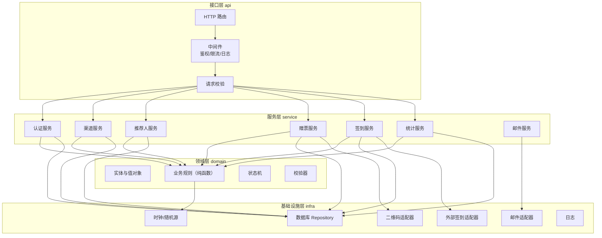

# KCon2026 赠票系统 系统架构设计
| 项 | 内容 |
|---|---|
| 文档编号 | KCON-ARCH-001 |
| 版本 | V1.0 |
| 状态 | 已评审通过 |
| 上游 | KCON-SRS-001 需求规格说明书 V3.0 |

> **v1 边界**：签到相关模块保留但不对外暴露；现场签到由下游 KconLucky 系统负责。
> 本系统只产出「已通过的赠票接收人」名单，通过 CSV 交接给下游（见 `specs/011-gift-ticket-handoff`）。
---
## 1. 架构目标
基于规模基线（**20 渠道 / 500 票 / 10 次每秒签到**），架构设计遵循三条原则：
1. **够用就好**：不引入分布式组件，单机可跑，降低运维与测试成本；
2. **可测试优先**：分层清晰，领域层纯函数，依赖可注入，覆盖率可达 100%；
3. **边界清晰**：外部系统（邮件、二维码、外部签到）全部通过适配器隔离，可 Mock。
---
## 2. 总体架构
### 2.1 分层视图

### 2.2 分层职责与测试策略
| 层 | 职责 | 依赖 | 测试方式 | 覆盖率目标 |
|---|---|---|---|---|
| **domain 领域层** | 实体、值对象、业务规则、状态机、校验器。**纯函数，无 I/O** | 仅标准库 | 单元测试（无 Mock） | 100%/100%/90% |
| **service 服务层** | 编排业务用例，调用领域规则与仓储 | domain + infra | 集成测试（真实 SQLite） | 100%/100%/90% |
| **infra 基础设施层** | 数据持久化、邮件、二维码、外部适配 | 外部库 | 单元 + 集成（部分 Mock 外部） | 100%/100%/90% |
| **api 接口层** | HTTP 路由、中间件、序列化 | service | 系统测试（真实 HTTP） | 100%/100%/90% |
> **关键设计**：业务规则全部下沉到 domain 层纯函数，使 80% 的逻辑可以用无 Mock 的单元测试覆盖，这是达成 100% 覆盖率的前提。
---
## 3. 模块设计
### 3.1 目录结构
```
kcon-prod/
├── src/kcon/
│   ├── __init__.py
│   ├── app.py                  # 应用装配（依赖注入容器）
│   ├── config.py               # 配置（管理员 MD5、参数）
│   ├── domain/                 # 领域层（纯函数）
│   │   ├── __init__.py
│   │   ├── models.py           # 实体与值对象（dataclass）
│   │   ├── enums.py            # 状态枚举
│   │   ├── validators.py       # 字段校验器
│   │   ├── rules.py            # 业务规则（配额/上限/互斥/重申）
│   │   ├── state_machine.py    # 状态流转
│   │   └── codes.py            # 编码生成规则
│   ├── infra/                  # 基础设施层
│   │   ├── __init__.py
│   │   ├── clock.py            # Clock 抽象 + 系统实现 + 固定实现
│   │   ├── random_source.py    # RandomSource 抽象
│   │   ├── database.py         # 连接与建表
│   │   ├── repositories.py     # 各表仓储
│   │   ├── mailer.py           # 邮件适配器（outbox/smtp）
│   │   ├── qrcode_gen.py       # 二维码适配器
│   │   ├── external_checkin.py # 外部签到适配器（空实现）
│   │   └── logger.py           # 日志
│   ├── service/                # 服务层
│   │   ├── __init__.py
│   │   ├── auth_service.py
│   │   ├── channel_service.py
│   │   ├── referrer_service.py
│   │   ├── ticket_service.py
│   │   ├── checkin_service.py
│   │   ├── stats_service.py
│   │   └── mail_service.py
│   └── api/                    # 接口层
│       ├── __init__.py
│       ├── router.py           # 路由表
│       ├── handlers.py         # 请求处理
│       ├── middleware.py       # 鉴权/限流/日志
│       └── server.py           # HTTP 服务器
├── tests/
│   ├── unit/                   # 单元测试
│   ├── integration/            # 集成测试
│   └── system/                 # 系统测试
├── docs/
│   ├── engineering/            # 工程文档
│   └── process/                # 过程文档
├── scripts/                    # 启动/测试脚本
└── reports/                    # 测试报告与覆盖率
```
### 3.2 依赖注入设计
```python
# app.py 装配示例（伪代码）
class Container:
    def __init__(self, config, clock=None, random_source=None,
                 mailer=None, qr_gen=None, external=None, db_path=None):
        self.clock = clock or SystemClock()
        self.random = random_source or SecureRandom()
        self.db = Database(db_path or config.DB_PATH)
        self.repos = Repositories(self.db)
        self.mailer = mailer or OutboxMailer(self.repos.email)
        self.qr = qr_gen or QrCodeGenerator()
        self.external = external or NullExternalCheckin()
        # 服务层
        self.auth = AuthService(self.repos, self.clock, self.random, config)
        self.channel = ChannelService(self.repos, self.clock, self.random,
                                      self.mailer, config)
        ...
```
**测试优势**：单元测试注入 `FixedClock` + `SequenceRandom`，结果完全确定；集成测试注入真实 SQLite + `InMemoryMailer`。
---
## 4. 关键技术决策
| 编号 | 决策 | 理由 | 备选方案与否决原因 |
|---|---|---|---|
| D1 | SQLite 单库 | 500 票规模，单机足够；零运维 | MySQL：需额外服务，测试成本高 |
| D2 | 标准库 http.server | 无框架依赖，测试可直接起服务 | Flask/FastAPI：引入依赖，覆盖率统计复杂 |
| D3 | 领域层纯函数 | 无 Mock 单测，覆盖率易达 100% | 贫血模型：逻辑散落服务层，难测 |
| D4 | Clock/Random 抽象 | 时间与随机可固定，测试确定性 | 直接调 time/random：测试不可复现 |
| D5 | 邮件 outbox 模式 | Demo/测试不真发信，可断言 | 直接 SMTP：测试需真实邮箱 |
| D6 | 外部签到空实现 | 甲方未定接口，先隔离 | 硬编码：后续接入要改主流程 |
| D7 | 单进程 + 线程池 | 10 次/秒签到足够 | 多进程：SQLite 写锁冲突 |
| **D8** | **更换渠道审批员时作废并重签令牌** | **防止离职人员凭旧链接越权审批；replace_approver 停用旧人→新建→作废旧令牌→为待审批推荐人重签发新令牌** | 仅作废不重签：积压申请无人可批 |
---
## 5. 并发与一致性
### 5.1 并发场景
| 场景 | 并发量 | 处理方式 |
|---|---|---|
| 签到扫码 | 10 次/秒 | 线程池 + SQLite WAL 模式 |
| 注册提交 | 50 用户 | 线程池 + 唯一索引兜底 |
| 邮件发送 | 异步队列 | 后台线程 + 重试 |
### 5.2 一致性保障
1. **配额与上限**：`BEGIN IMMEDIATE` 事务内校验 + 更新，防超发；
2. **邮箱唯一**：数据库 `UNIQUE` 索引兜底，捕获 `IntegrityError` 转业务提示；
3. **令牌一次性**：`UPDATE token SET used_at=? WHERE id=? AND used_at IS NULL`，检查 `rowcount`；
4. **重复签到**：`recipient.status` 条件更新 + `checkin` 表 `UNIQUE(recipient_id)`。
### 5.3 SQLite 配置
```sql
PRAGMA journal_mode = WAL;      -- 读写并发
PRAGMA synchronous = NORMAL;    -- 性能与安全平衡
PRAGMA busy_timeout = 5000;     -- 写锁等待 5 秒
PRAGMA foreign_keys = ON;
```
---
## 6. 部署架构
### 6.1 单机部署
```
┌─────────────────────────────────┐
│  单台服务器（2C4G 足够）          │
│  ┌───────────────────────────┐  │
│  │ Python 进程（HTTP 服务）    │  │
│  │  - 线程池 20 线程          │  │
│  └──────────┬────────────────┘  │
│             │                    │
│  ┌──────────▼────────────────┐  │
│  │ SQLite（WAL 模式）         │  │
│  │  data/kcon.db             │  │
│  └───────────────────────────┘  │
│  ┌───────────────────────────┐  │
│  │ 静态文件（CSS/JS/图片）     │  │
│  └───────────────────────────┘  │
└─────────────────────────────────┘
         │
         ▼
   外部 SMTP（kcon@knownsec.com）
   外部签到系统（本期空）
```
### 6.2 容量核算
| 资源 | 用量 | 余量 |
|---|---|---|
| 数据库大小 | 500 票 × 2KB ≈ 1MB | 极大 |
| 内存 | 进程 80MB + 线程池 20MB | 4G 充足 |
| 磁盘 | 代码 2MB + 数据 5MB + 日志 50MB | 充足 |
| 网络 | 峰值 10 请求/秒 | 带宽无压力 |
---
## 7. 安全设计
| 层面 | 措施 |
|---|---|
| 传输 | HTTPS（生产由反向代理终止） |
| 认证 | 邮箱 + 验证码；签到员账号 + bcrypt |
| 会话 | 随机 32 位 SID，2 小时过期 |
| 授权 | 中间件按角色校验 + 服务层对象级校验（双保险） |
| 输入 | 全部字段服务端校验，长度/格式/枚举 |
| 输出 | 按角色脱敏（签到员无手机邮箱） |
| 防枚举 | 16 位 base62 随机串 |
| 防重放 | 一次性令牌 + `used_at` 条件更新 |
| 防越权 | 跨渠道访问返回 403，记审计日志 |
| 审计 | 所有管理动作写 `audit_log` |
---
## 8. 可观测性
| 项 | 实现 |
|---|---|
| 日志 | 结构化 JSON，分级 DEBUG/INFO/WARN/ERROR |
| 审计 | `audit_log` 表，记录操作人/动作/对象/IP/时间 |
| 邮件日志 | `email_log` 表，记录模板/收件人/状态/错误/重试次数 |
| 健康检查 | `GET /healthz` 返回 DB 连通性 |
| 关键指标 | 渠道数、票数、签到数、邮件成功率（统计接口） |
---
## 9. 评审记录
| 评审项 | 结论 | 评审人 | 日期 |
|---|---|---|---|
| 分层是否合理 | 通过，领域层纯函数是关键 | 架构组 | 2026-10-25 |
| 规模是否支撑 | 通过，单机余量充足 | 架构组 | 2026-10-25 |
| 可测试性 | 通过，Clock/Random 抽象到位 | 测试组 | 2026-10-25 |
| 安全设计 | 通过，双保险授权 | 安全组 | 2026-10-25 |