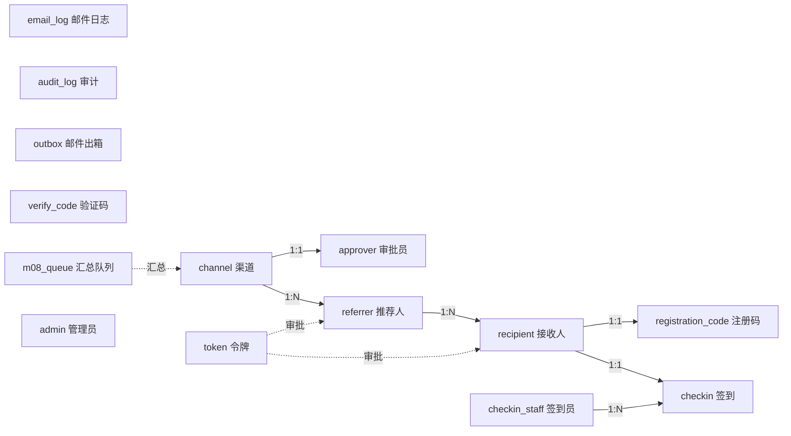

# KCon2026 赠票系统 数据库设计
| 项 | 内容 |
|---|---|
| 文档编号 | KCON-DB-001 |
| 版本 | V1.0 |
| 数据库 | SQLite 3.50（WAL 模式） |
| 规模 | 20 渠道 / 500 票 / 400 推荐人 |
---
## 1. 设计原则
1. **单库单表**：规模小，不做分库分表；
2. **唯一索引兜底**：邮箱、编码等关键字段加 UNIQUE，防并发重复；
3. **软删除优先**：渠道、推荐人停用而非物理删除，保留历史；
4. **冗余换性能**：`referrer.issued_count` 冗余计数，避免每次 COUNT；
5. **审计完整**：所有管理动作落 `audit_log`。
---
## 2. ER 图

---
## 3. 表结构
### 3.1 admin（系统管理员）
| 字段 | 类型 | 约束 | 说明 |
|---|---|---|---|
| id | INTEGER | PK AUTOINCREMENT | |
| email_md5 | TEXT | NOT NULL UNIQUE | 邮箱 MD5 |
| name | TEXT | NOT NULL | 显示名 |
| status | INTEGER | NOT NULL DEFAULT 1 | 1 启用 / 0 停用 |
| created_at | TEXT | NOT NULL | |
**约束**：`status=1` 记录数 ≤ 3（应用层校验 + 触发器兜底）。
**容量**：3 行。
### 3.2 channel（渠道）
| 字段 | 类型 | 约束 | 说明 |
|---|---|---|---|
| id | INTEGER | PK | |
| name | TEXT | NOT NULL UNIQUE | 渠道名称 |
| code | TEXT | NOT NULL UNIQUE | 16 位随机码 |
| quota | INTEGER | NOT NULL CHECK(quota BETWEEN 1 AND 500) | 配额 |
| referrer_cap | INTEGER | NOT NULL DEFAULT 20 CHECK(referrer_cap BETWEEN 1 AND 100) | 单人上限 |
| remark | TEXT | DEFAULT '' | 备注 |
| status | INTEGER | NOT NULL DEFAULT 1 | 1 启用 / 2 暂停 / 3 删除 |
| created_by | INTEGER | | 创建管理员 |
| created_at | TEXT | NOT NULL | |
| updated_at | TEXT | NOT NULL | |
**索引**：`UNIQUE(name)`、`UNIQUE(code)`、`INDEX(status)`。
**容量**：≤ 20 行。
### 3.3 approver（渠道审批员）
| 字段 | 类型 | 约束 | 说明 |
|---|---|---|---|
| id | INTEGER | PK | |
| channel_id | INTEGER | NOT NULL FK→channel(id) | |
| name | TEXT | NOT NULL | |
| email | TEXT | NOT NULL UNIQUE | |
| status | INTEGER | NOT NULL DEFAULT 1 | |
| last_login_at | TEXT | | |
| created_at | TEXT | NOT NULL | |
**索引**：`UNIQUE(email)`、`INDEX(channel_id)`。
**容量**：≤ 20 行。
### 3.4 referrer（推荐人）
| 字段 | 类型 | 约束 | 说明 |
|---|---|---|---|
| id | INTEGER | PK | |
| channel_id | INTEGER | NOT NULL FK | |
| name | TEXT | NOT NULL | |
| company | TEXT | NOT NULL | |
| department | TEXT | NOT NULL | |
| mobile | TEXT | NOT NULL | |
| email | TEXT | NOT NULL UNIQUE | |
| code | TEXT | NOT NULL UNIQUE | 16 位随机码 |
| status | INTEGER | NOT NULL DEFAULT 1 | 1 待审 / 2 通过 / 3 拒绝 / 4 停用 |
| issued_count | INTEGER | NOT NULL DEFAULT 0 | **冗余：已发放数** |
| approved_by | INTEGER | | |
| approved_at | TEXT | | |
| rejected_at | TEXT | | |
| created_at | TEXT | NOT NULL | |
**索引**：`UNIQUE(email)`、`UNIQUE(code)`、`INDEX(channel_id)`、`INDEX(status)`。
**容量**：≤ 400 行。
### 3.5 recipient（赠票接收人）
| 字段 | 类型 | 约束 | 说明 |
|---|---|---|---|
| id | INTEGER | PK | |
| referrer_id | INTEGER | NOT NULL FK | |
| channel_id | INTEGER | NOT NULL FK | 冗余便于统计 |
| name | TEXT | NOT NULL | |
| company | TEXT | NOT NULL | |
| mobile | TEXT | DEFAULT '' | 可空 |
| email | TEXT | NOT NULL UNIQUE | |
| status | INTEGER | NOT NULL DEFAULT 1 | 1 待审 / 2 通过 / 3 拒绝 / 4 签到 / 5 作废 |
| approved_at | TEXT | | |
| created_at | TEXT | NOT NULL | |
**索引**：`UNIQUE(email)`、`INDEX(referrer_id)`、`INDEX(channel_id)`、`INDEX(status)`。
**容量**：≤ 500 行。
### 3.6 registration_code（注册码）
| 字段 | 类型 | 约束 | 说明 |
|---|---|---|---|
| id | INTEGER | PK | |
| recipient_id | INTEGER | NOT NULL UNIQUE FK | 一票一码 |
| code | TEXT | NOT NULL UNIQUE | 16 位大写字母数字 |
| qr_url | TEXT | DEFAULT '' | 二维码图片地址 |
| qr_content | TEXT | DEFAULT '' | 二维码内容 URL |
| issued_at | TEXT | NOT NULL | |
**索引**：`UNIQUE(recipient_id)`、`UNIQUE(code)`。
**容量**：≤ 500 行。
### 3.7 checkin（签到记录）
| 字段 | 类型 | 约束 | 说明 |
|---|---|---|---|
| id | INTEGER | PK | |
| recipient_id | INTEGER | NOT NULL UNIQUE FK | 一人一次 |
| checked_at | TEXT | NOT NULL | |
| staff_id | INTEGER | FK | |
| device_ip | TEXT | DEFAULT '' | |
| material_issued | INTEGER | NOT NULL DEFAULT 1 | 是否发材料 |
| external_sync_status | INTEGER | NOT NULL DEFAULT 0 | 0 未同步 / 1 成功 / 2 失败 |
| external_sync_at | TEXT | | |
| external_response | TEXT | | |
**索引**：`UNIQUE(recipient_id)`、`INDEX(checked_at)`。
**容量**：≤ 500 行。
### 3.8 checkin_staff（签到工作人员）
| 字段 | 类型 | 约束 | 说明 |
|---|---|---|---|
| id | INTEGER | PK | |
| name | TEXT | NOT NULL | |
| account | TEXT | NOT NULL UNIQUE | |
| password_hash | TEXT | NOT NULL | bcrypt |
| status | INTEGER | NOT NULL DEFAULT 1 | |
| created_by | INTEGER | | |
| created_at | TEXT | NOT NULL | |
**容量**：≤ 20 行。
### 3.9 token（一次性令牌）
| 字段 | 类型 | 约束 | 说明 |
|---|---|---|---|
| id | INTEGER | PK | |
| token | TEXT | NOT NULL UNIQUE | 32 位随机 |
| type | INTEGER | NOT NULL | 1 推荐人审批 / 2 赠票审批 |
| target_id | INTEGER | NOT NULL | |
| owner_id | INTEGER | NOT NULL | 归属 |
| expires_at | TEXT | NOT NULL | 7 天 |
| used_at | TEXT | | 非空即失效 |
| created_at | TEXT | NOT NULL | |
**索引**：`UNIQUE(token)`、`INDEX(type, target_id)`、`INDEX(expires_at)`。
**容量**：≤ 1000 行（每审批一个）。
**令牌作废策略【V3.1】**：更换渠道审批员时，调用 `invalidate_by_owner(type=1, owner_id=channel_id)` 批量将该渠道未使用令牌置为已用；随后为每个待审批推荐人重新签发新令牌。owner_id 对推荐人审批令牌即 channel_id，故可按渠道整体作废。
### 3.10 email_log（邮件日志）
| 字段 | 类型 | 约束 | 说明 |
|---|---|---|---|
| id | INTEGER | PK | |
| template | TEXT | NOT NULL | M-01～M-09 / CODE |
| to_email | TEXT | NOT NULL | |
| subject | TEXT | NOT NULL | |
| status | INTEGER | NOT NULL DEFAULT 1 | 1 成功 / 0 失败 |
| error | TEXT | | |
| retry_count | INTEGER | NOT NULL DEFAULT 0 | |
| sent_at | TEXT | NOT NULL | |
**索引**：`INDEX(template)`、`INDEX(status)`、`INDEX(sent_at)`。
**容量**：≤ 2000 行。
### 3.11 audit_log（审计日志）
| 字段 | 类型 | 约束 | 说明 |
|---|---|---|---|
| id | INTEGER | PK | |
| actor_type | TEXT | NOT NULL | admin/approver/staff/referrer |
| actor_id | INTEGER | | |
| action | TEXT | NOT NULL | |
| target_type | TEXT | | |
| target_id | INTEGER | | |
| detail | TEXT | | |
| ip | TEXT | DEFAULT '' | |
| created_at | TEXT | NOT NULL | |
**索引**：`INDEX(actor_type, actor_id)`、`INDEX(created_at)`。
**容量**：≤ 5000 行。
### 3.12 outbox（邮件出箱，Demo/测试用）
| 字段 | 类型 | 约束 | 说明 |
|---|---|---|---|
| id | INTEGER | PK | |
| template | TEXT | NOT NULL | |
| to_email | TEXT | NOT NULL | |
| subject | TEXT | NOT NULL | |
| html | TEXT | NOT NULL | 完整 HTML |
| created_at | TEXT | NOT NULL | |
**容量**：≤ 2000 行。
### 3.13 verify_code（验证码）
| 字段 | 类型 | 约束 | 说明 |
|---|---|---|---|
| id | INTEGER | PK | |
| email | TEXT | NOT NULL | |
| code | TEXT | NOT NULL | 6 位 |
| scene | TEXT | NOT NULL DEFAULT 'login' | |
| expires_at | TEXT | NOT NULL | |
| used | INTEGER | NOT NULL DEFAULT 0 | |
| fail_count | INTEGER | NOT NULL DEFAULT 0 | |
| created_at | TEXT | NOT NULL | |
**索引**：`INDEX(email, created_at)`。
**容量**：≤ 3000 行（可定期清理 7 天前）。
### 3.14 m08_queue（M-08 汇总队列）
| 字段 | 类型 | 约束 | 说明 |
|---|---|---|---|
| id | INTEGER | PK | |
| channel_id | INTEGER | NOT NULL | |
| recipient_id | INTEGER | NOT NULL | |
| created_at | TEXT | NOT NULL | |
| sent | INTEGER | NOT NULL DEFAULT 0 | |
**索引**：`INDEX(channel_id, sent)`。
**容量**：≤ 500 行。
---
## 4. 容量估算
| 表 | 行数上限 | 单行大小 | 总大小 |
|---|---|---|---|
| admin | 3 | 100B | 0.3KB |
| channel | 20 | 300B | 6KB |
| approver | 20 | 200B | 4KB |
| referrer | 400 | 400B | 160KB |
| recipient | 500 | 400B | 200KB |
| registration_code | 500 | 300B | 150KB |
| checkin | 500 | 300B | 150KB |
| checkin_staff | 20 | 200B | 4KB |
| token | 1000 | 200B | 200KB |
| email_log | 2000 | 300B | 600KB |
| audit_log | 5000 | 300B | 1.5MB |
| outbox | 2000 | 5KB | **10MB** |
| verify_code | 3000 | 150B | 450KB |
| m08_queue | 500 | 100B | 50KB |
| **合计** | | | **≈ 13.5MB** |
> 结论：数据库总大小约 13.5MB，SQLite 完全胜任。
---
## 5. 关键 SQL
### 5.1 配额校验（事务内）
```sql
BEGIN IMMEDIATE;
SELECT COUNT(*) FROM recipient
 WHERE channel_id = ? AND status IN (2, 4);
-- 若 < quota 则继续
UPDATE referrer SET issued_count = issued_count + 1 WHERE id = ?;
INSERT INTO recipient (...) VALUES (...);
COMMIT;
```
### 5.2 令牌一次性使用
```sql
UPDATE token SET used_at = ?
 WHERE token = ? AND type = ? AND used_at IS NULL;
-- rowcount == 1 才算成功
```
### 5.3 签到防重复
```sql
INSERT INTO checkin (recipient_id, ...) VALUES (?, ...);
-- UNIQUE(recipient_id) 冲突则说明已签到
UPDATE recipient SET status = 4 WHERE id = ? AND status = 2;
-- rowcount == 1 才算成功
```
### 5.4 统计查询（管理员）
```sql
SELECT
  (SELECT COUNT(*) FROM channel WHERE status = 1) AS channel_count,
  (SELECT COUNT(*) FROM referrer) AS referrer_count,
  (SELECT COUNT(*) FROM recipient) AS invited_count,
  (SELECT COUNT(*) FROM recipient WHERE status IN (2,4)) AS approved_count,
  (SELECT COUNT(*) FROM recipient WHERE status = 4) AS checked_in_count;
```
---
## 6. 数据保留策略
| 数据 | 保留期 | 处理 |
|---|---|---|
| 业务数据（渠道/推荐人/接收人/签到） | 会后 6 个月 | 匿名化姓名/手机/邮箱 |
| 邮件出箱 outbox | 会后 1 个月 | 删除 |
| 验证码 verify_code | 7 天 | 定时清理 |
| 审计日志 audit_log | 1 年 | 归档 |
| 邮件日志 email_log | 6 个月 | 归档 |
---
## 7. 评审记录
| 评审项 | 结论 | 评审人 |
|---|---|---|
| 表结构完整性 | 通过，覆盖全部实体 | 架构组 |
| 索引合理性 | 通过，查询路径均有索引 | 架构组 |
| 容量估算 | 通过，13.5MB 远低于上限 | 架构组 |
| 并发一致性 | 通过，事务 + 唯一索引双保险 | 安全组 |