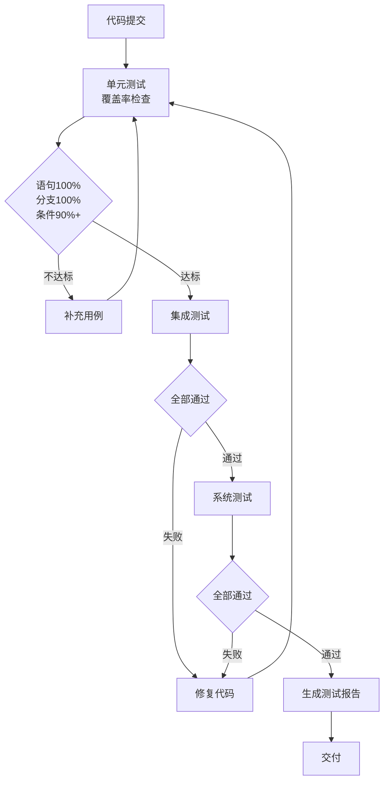

# KCon2026 赠票系统 测试计划
| 项 | 内容 |
|---|---|
| 文档编号 | KCON-TEST-001 |
| 版本 | V1.0 |
| 工具 | pytest 9.1.1 + coverage 7.17 + pytest-cov 7.1 |
| 门禁 | 语句 100% / 分支 100% / 条件 ≥ 90% |
---
## 1. 测试目标
| 目标 | 衡量 |
|---|---|
| 功能正确 | 全部 24 个接口按规格返回 |
| 业务规则正确 | 16 条核心规则全部有对应用例 |
| 覆盖率达标 | 语句 100%、分支 100%、条件 ≥ 90% |
| 规模可支撑 | 20 渠道 500 票全流程通过 |
| 安全可控 | 越权、枚举、重放、重复签到全部拦截 |
---
## 2. 测试分层策略
### 2.1 三层分工
| 层 | 测试对象 | 依赖处理 | 用例数 | 执行速度 |
|---|---|---|---|---|
| **单元测试** | domain 层纯函数、validators、rules、state_machine、codes、infra 的 clock/random | **无依赖**，纯内存 | ≥ 120 | < 1 秒 |
| **集成测试** | service 层 + 真实 SQLite + InMemoryMailer | 真实 DB，Mock 外部 | ≥ 40 | < 5 秒 |
| **系统测试** | api 层 + 真实 HTTP + 全流程 | 全真实（除 SMTP） | ≥ 15 场景 | < 30 秒 |
### 2.2 覆盖率归属
| 模块 | 主要覆盖层 | 说明 |
|---|---|---|
| `domain/*` | 单元测试 | 纯函数，100% 可达 |
| `infra/clock.py`、`random_source.py` | 单元测试 | 简单，100% 可达 |
| `infra/database.py`、`repositories.py` | 集成测试 | 需真实 DB |
| `infra/mailer.py`、`qrcode_gen.py` | 集成 + 单元 | 外部部分 Mock |
| `service/*` | 集成测试 | 编排逻辑 |
| `api/*` | 系统测试 | HTTP 层 |
| `config.py` | 单元测试 | 常量与函数 |
| `app.py` | 集成测试 | 装配逻辑 |
---
## 3. 覆盖率达成策略
### 3.1 语句覆盖率 100%
**手段**：
1. 每个函数至少一个用例；
2. 每个 `return` 语句都有用例触发；
3. 异常分支用 `pytest.raises` 覆盖；
4. 用 `coverage report --show-missing` 逐行核对未覆盖行；
5. **禁止 `# pragma: no cover` 滥用**，仅允许用于：
   - `if __name__ == "__main__":` 块
   - 类型检查 `if TYPE_CHECKING:`
   - 明确的平台分支（如 Windows-only）
### 3.2 分支覆盖率 100%
**手段**：
1. 每个 `if/elif/else` 的**真、假两个方向**都要有用例；
2. 每个 `try/except` 的**正常、异常**都要覆盖；
3. 每个 `while/for` 的**进入、不进入**都要覆盖；
4. 三元表达式 `a if c else b` 两侧都要覆盖；
5. 短路运算 `a and b`、`a or b` 的短路与非短路路径都要覆盖。
**示例**：
```python
# 被测代码
def check_quota(used, quota):
    if used >= quota:          # 分支 1：真 / 假
        return False, "已发完"
    return True, "可发放"
# 测试用例
def test_quota_full():         # 覆盖真分支
    assert check_quota(10, 10) == (False, "已发完")
def test_quota_available():    # 覆盖假分支
    assert check_quota(9, 10) == (True, "可发放")
```
### 3.3 条件覆盖率 ≥ 90%
**定义**：复合条件中每个原子条件的真/假都被独立验证。
**手段**：
1. 复合条件拆解测试（MC/DC 思路）；
2. 每个原子条件至少一次真、一次假；
3. 用 `coverage` 的 `--branch` 模式统计。
**示例**：
```python
# 被测代码：复合条件
def can_register(referrer_status, channel_status, issued, cap):
    if referrer_status == 2 and channel_status == 1 and issued < cap:
        return True
    return False
# 测试用例矩阵（覆盖每个原子条件）
# 1. 全真 → True
# 2. referrer_status != 2 → False（原子1假）
# 3. channel_status != 1 → False（原子2假）
# 4. issued >= cap → False（原子3假）
```
### 3.4 覆盖率检查命令
```bash
# 全量测试 + 覆盖率
.venv/bin/pytest tests/ \
  --cov=src/kcon \
  --cov-branch \
  --cov-report=term-missing \
  --cov-report=html:reports/htmlcov \
  --cov-report=xml:reports/coverage.xml \
  --cov-fail-under=100
# 查看未覆盖行
.venv/bin/coverage report --show-missing
```
### 3.5 门禁脚本
```bash
# scripts/check_coverage.sh
#!/bin/bash
set -e
.venv/bin/pytest tests/ --cov=src/kcon --cov-branch \
  --cov-report=term-missing --cov-fail-under=100
# 条件覆盖率单独统计（自定义脚本）
.venv/bin/python scripts/condition_coverage.py
```
---
## 4. 单元测试设计
### 4.1 测试范围
| 模块 | 测试点 | 用例数 |
|---|---|---|
| `domain/validators.py` | 邮箱、手机、姓名、公司、部门、配额、上限的长度与格式 | 30 |
| `domain/rules.py` | 配额校验、上限校验、邮箱唯一、令牌互斥、7 天重申、计数口径 | 35 |
| `domain/state_machine.py` | 推荐人 4 状态、接收人 5 状态、渠道 3 状态的合法/非法流转 | 25 |
| `domain/codes.py` | 渠道码、推荐人码、注册码、令牌的格式与字符集 | 10 |
| `domain/models.py` | dataclass 构造、默认值、序列化 | 10 |
| `infra/clock.py` | SystemClock、FixedClock | 5 |
| `infra/random_source.py` | SecureRandom、SequenceRandom | 5 |
| `config.py` | 管理员白名单、参数边界 | 10 |
| **合计** | | **≥ 130** |
### 4.2 测试数据构造
```python
# tests/unit/conftest.py
import pytest
from kcon.infra.clock import FixedClock
from kcon.infra.random_source import SequenceRandom
@pytest.fixture
def fixed_clock():
    return FixedClock("2026-10-25 10:00:00")
@pytest.fixture
def seq_random():
    return SequenceRandom(["CODE1", "CODE2", "CODE3"])
```
### 4.3 命名规范
```
test_<被测函数>_<场景>_<预期>
例：test_validate_email_invalid_format_returns_error
    test_check_quota_full_returns_false
```
---
## 5. 集成测试设计
### 5.1 测试范围
| 服务 | 测试点 | 用例数 |
|---|---|---|
| `auth_service` | 发码、限频、单日上限、验证、锁定、角色判定 | 12 |
| `channel_service` | 创建、重名、邮箱冲突、20 上限、停用、删除 | 10 |
| `referrer_service` | 注册、审批通过/拒绝、互斥、7 天重申、跨渠道 | 10 |
| `ticket_service` | 注册 5 项校验、审批、配额、上限、注册码生成 | 12 |
| `checkin_service` | 查询、签到、重复、状态异常、外部同步、M-08 汇总 | 10 |
| `channel_service.replace_approver` | 换人成功/参数校验/渠道停用/邮箱冲突/旧令牌作废/待审批重签/无当前审批员 | 9 |
| `handlers.admin_replace_approver` | 接口成功/越权403/未登录401 | 3 |
| `stats_service` | 管理员统计、渠道统计、签到率 | 5 |
| `mail_service` | 10 封模板渲染、失败重试 | 10 |
| **合计** | | **≥ 69** |
### 5.2 测试数据库
```python
# tests/integration/conftest.py
import pytest, tempfile, os
from kcon.app import Container
@pytest.fixture
def container(tmp_path):
    db_path = tmp_path / "test.db"
    c = Container(db_path=str(db_path))
    c.db.init_schema()
    return c
```
**隔离**：每个用例独立临时数据库，用后自动删除。
### 5.3 邮件断言
```python
def test_create_channel_sends_m01(container):
    ok, msg = container.channel.create(...)
    assert ok
    mails = container.repos.outbox.list_all()
    assert len(mails) == 1
    assert mails[0]["template"] == "M-01"
    assert "您的渠道管理账号已开通" in mails[0]["subject"]
```
---
## 6. 系统测试设计
### 6.1 测试场景（15 个）
| # | 场景 | 验证点 |
|---|---|---|
| S1 | 完整主流程（建渠道→推荐人→赠票→签到） | 全链路打通，邮件 8 封 |
| S2 | 管理员数量上限 | 第 4 个创建失败 |
| S3 | 渠道数量上限 20 | 第 21 个失败 |
| S4 | 单人上限拦截 | 超限提交被拒 |
| S5 | 渠道配额拦截 | 配额用尽提交被拒 |
| S6 | 邮箱重复提交时拦截 | 提交即报错 |
| S7 | 一次性链接复用 | 第二次失败 |
| S8 | 被拒 7 天重申 | 7 天内失败、7 天后成功 |
| S9 | 重复签到 | 第二次提示已签到 |
| S10 | 跨渠道越权 | 403 |
| S11 | 未登录访问 | 401 |
| S12 | 落地页分级 | 未登录无个人信息 |
| S13 | M-08 汇总（满 10 人） | 第 10 人触发汇总 |
| S14 | 外部接口失败不阻断 | 签到仍成功 |
| S15 | **20 渠道 500 票压测** | 全流程通过，耗时 < 60 秒 |
| S16 | **更换审批员端到端** | 旧令牌失效、新申请改道、积压重签可批 |
### 6.2 压测设计
```python
def test_full_scale_20_channels_500_tickets(server):
    """20 渠道 × 25 票 = 500 票全流程"""
    for i in range(20):
        ch = create_channel(f"渠道{i}", quota=25, cap=5)
        for j in range(5):
            ref = register_and_approve_referrer(ch, j)
            for k in range(5):
                rc = register_and_approve_ticket(ref, k)
                if k % 2 == 0:
                    checkin(rc)
    # 断言
    stats = get_admin_stats()
    assert stats["channel_count"] == 20
    assert stats["approved_count"] == 500
    assert stats["checked_in_count"] == 250
```
### 6.3 性能断言
| 场景 | 指标 | 断言 |
|---|---|---|
| 签到单次 | ≤ 300ms | `assert elapsed < 0.3` |
| 统计查询 | ≤ 1 秒 | `assert elapsed < 1.0` |
| 500 票全流程 | ≤ 60 秒 | `assert elapsed < 60` |
---
## 7. 测试执行流程

---
## 8. 缺陷分级
| 级别 | 定义 | 处理时限 |
|---|---|---|
| P0 致命 | 主流程不通、数据错乱、安全漏洞 | 立即修复 |
| P1 严重 | 业务规则错误、覆盖率不达标 | 当天修复 |
| P2 一般 | 提示文案、边界处理 | 3 天内 |
| P3 轻微 | UI 细节 | 下版本 |
---
## 9. 测试交付物
| 交付物 | 路径 |
|---|---|
| 单元测试代码 | `tests/unit/` |
| 集成测试代码 | `tests/integration/` |
| 系统测试代码 | `tests/system/` |
| 覆盖率报告（HTML） | `reports/htmlcov/index.html` |
| 覆盖率报告（XML） | `reports/coverage.xml` |
| 测试执行报告 | `docs/process/测试执行报告.md` |
| 缺陷记录 | `docs/process/缺陷记录.md` |
---
## 10. 评审记录
| 评审项 | 结论 | 评审人 |
|---|---|---|
| 分层是否合理 | 通过，单元测试无依赖是关键 | 测试组 |
| 覆盖率策略 | 通过，明确到每条分支 | 测试组 |
| 用例数量 | 通过，130+69+15 满足要求 | 测试组 |
| 压测设计 | 通过，20 渠道 500 票覆盖规模基线 | 架构组 |