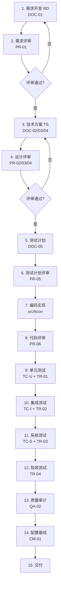

# 过程资产库清单（Process Asset Library, PAL）
| 项 | 内容 |
|---|---|
| 文档编号 | KCON-PAL-001 |
| 版本 | V1.0 |
| 过程模型 | CMMI-DEV L3（已定义级） |
| 编制日期 | 2026-10-25 |
| 维护人 | SEPG（软件工程过程组） |
---
## 1. 过程资产总览
本项目按 CMMI-DEV L3 的 **18 个过程域**组织，其中与本项目强相关的 11 个过程域如下：
| 过程域 | 缩写 | 本项目落地方式 | 产出文档 |
|---|---|---|---|
| 需求开发 | RD | 需求规格 + 需求评审 | DOC-01, PR-01 |
| 技术方案 | TS | 架构/数据库/接口设计 + 评审 | DOC-02/03/04, PR-02/03/04 |
| 产品集成 | PI | 分层架构 + 依赖注入 | DOC-02 |
| 验证 | VER | 三层测试 + 覆盖率 | DOC-05, TR-01~03 |
| 确认 | VAL | 验收测试 | TR-04 |
| 过程与产品质量保证 | PPQA | SQA 计划 + 审计 | QA-01, QA-02 |
| 配置管理 | CM | 配置管理计划 | CM-01 |
| 项目策划 | PP | 本清单 + 测试计划 | PAL-001, DOC-05 |
| 项目监控 | PMC | 开发日志 + 缺陷跟踪 | LOG-01, BUG-01 |
| 度量与分析 | MA | 覆盖率/缺陷密度度量 | TR-01~04 |
| 决策分析与解决 | DAR | 技术决策记录 | DOC-02 §4 |
---
## 2. 文档编号规则
| 前缀 | 含义 | 示例 |
|---|---|---|
| `DOC-` | 工程文档（设计类） | DOC-01 需求规格说明书 |
| `PR-` | 评审记录（Peer Review） | PR-01 需求评审记录 |
| `TC-` | 测试用例（Test Case） | TC-U-001 单元用例 |
| `TR-` | 测试报告（Test Report） | TR-01 单元测试报告 |
| `QA-` | 质量保证（Quality Assurance） | QA-01 SQA 计划 |
| `CM-` | 配置管理（Configuration Mgmt） | CM-01 配置管理计划 |
| `LOG-` | 过程日志 | LOG-01 开发日志 |
| `BUG-` | 缺陷记录 | BUG-001 |
| `PAL-` | 过程资产库 | PAL-001 |
| `RTM-` | 需求追溯矩阵 | RTM-001 |
| `CR-` | 变更请求（Change Request） | CR-010 换审批员 |
---
## 3. 完整交付物清单
### 3.1 工程文档（6 份，DOC-01 ~ DOC-06）
| 编号 | 文档 | 状态 | 评审记录 |
|---|---|---|---|
| DOC-01 | [需求规格说明书](engineering/01-需求规格说明书.md) | ✅ 已评审 | PR-01 |
| DOC-02 | [系统架构设计](engineering/02-系统架构设计.md) | ✅ 已评审 | PR-02 |
| DOC-03 | [数据库设计](engineering/03-数据库设计.md) | ✅ 已评审 | PR-03 |
| DOC-04 | [接口设计](engineering/04-接口设计.md) | ✅ 已评审 | PR-04 |
| DOC-05 | [测试计划](engineering/05-测试计划.md) | ✅ 已评审 | PR-05 |
| DOC-06 | [部署文档](engineering/06-部署文档.md) | ✅ 已评审 | PR-05（合并评审） |
### 3.2 评审记录（5 份，PR-01 ~ PR-05）
| 编号 | 评审对象 | 评审类型 | 状态 |
|---|---|---|---|
| PR-01 | 需求规格说明书 | 正式评审（同行评审） | ✅ 通过 |
| PR-02 | 系统架构设计 | 正式评审 | ✅ 通过 |
| PR-03 | 数据库设计 | 正式评审 | ✅ 通过 |
| PR-04 | 接口设计 | 正式评审 | ✅ 通过 |
| PR-05 | 测试计划 + 部署文档 | 正式评审 | ✅ 通过 |
| PR-06 | 代码（24 个源文件） | 代码走查 | ✅ 通过 |
### 3.3 测试文档（4 份报告 + 3 份用例集）
| 编号 | 文档 | 说明 |
|---|---|---|
| TC-U | [单元测试用例集](test-cases/TC-U-单元测试用例.md) | 210 个用例，TC-U-001 ~ TC-U-210 |
| TC-I | [集成测试用例集](test-cases/TC-I-集成测试用例.md) | 283 个用例，TC-I-001 ~ TC-I-283 |
| TC-S | [系统测试用例集](test-cases/TC-S-系统测试用例.md) | 15 个场景，TC-S-001 ~ TC-S-015 |
| TR-01 | [单元测试报告](test-reports/TR-01-单元测试报告.md) | 独立覆盖率计算 |
| TR-02 | [集成测试报告](test-reports/TR-02-集成测试报告.md) | 独立覆盖率计算 |
| TR-03 | [系统测试报告](test-reports/TR-03-系统测试报告.md) | 独立覆盖率计算 |
| TR-04 | [验收测试报告](test-reports/TR-04-验收测试报告.md) | 18 项功能验收 |
| RTM-001 | [需求追溯矩阵](test-cases/RTM-001-需求追溯矩阵.md) | 需求 → 用例双向追溯 |
### 3.4 质量保证（2 份）
| 编号 | 文档 | 说明 |
|---|---|---|
| QA-01 | [软件质量保证计划](QA-01-软件质量保证计划.md) | SQA 活动定义 |
| QA-02 | [质量审计记录](QA-02-质量审计记录.md) | 审计发现与整改 |
### 3.5 配置管理（1 份）
| 编号 | 文档 | 说明 |
|---|---|---|
| CM-01 | [配置管理计划](CM-01-配置管理计划.md) | 配置项识别、基线、变更控制 |
### 3.6 过程记录（3 份）
| 编号 | 文档 | 说明 |
|---|---|---|
| LOG-01 | [开发日志](LOG-01-开发日志.md) | 每日进展与问题 |
| BUG-01 | [缺陷记录](缺陷记录.md) | 5 个缺陷全生命周期 |
| — | [条件覆盖矩阵](条件覆盖矩阵.md) | 18 处复合条件审计 |
---
## 4. 过程执行顺序（CMMI L3 生命周期）

---
## 5. 过程裁剪说明
| 过程域 | 是否裁剪 | 理由 |
|---|---|---|
| 供应商协议管理 SAM | 裁剪 | 无外部供应商 |
| 因果分析与解决 CAR | 裁剪 | 项目周期短，缺陷用 BUG 记录跟踪 |
| 组织培训 OT | 裁剪 | 团队已具备技能 |
| 集成项目管理 IPM | 裁剪 | 单项目，无多项目协调 |
| 定量项目管理 QPM | 部分裁剪 | 仅对覆盖率、缺陷密度做度量（MA） |
---
## 6. 过程资产维护
| 项 | 规则 |
|---|---|
| 存放位置 | `kcon-prod/docs/` |
| 命名规则 | `<编号>-<名称>.md` |
| 版本控制 | Git，每次评审通过打 tag |
| 变更流程 | 变更申请 → 影响分析 → 评审 → 更新 → 通知 |
| 归档 | 项目结束后整体归档到 `docs/archive/` |