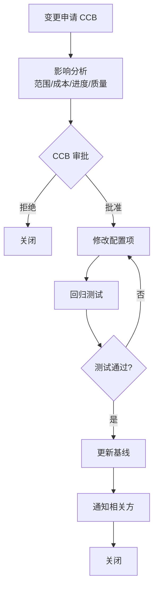

# CM-01 配置管理计划
| 项 | 内容 |
|---|---|
| 文档编号 | CM-01 |
| 版本 | V1.0 |
| 编制日期 | 2026-10-25 |
| 编制人 | 配置管理员 |
| 过程模型 | CMMI-DEV L3（CM 过程域） |
---
## 1. 目的
定义本项目的配置管理活动，确保：
1. 所有配置项被识别、标识、控制；
2. 变更受控且可追溯；
3. 基线可重建。
---
## 2. 配置项识别
### 2.1 配置项分类
| 类别 | 配置项 | 是否纳入基线 |
|---|---|---|
| **源代码** | `src/kcon/**/*.py`（24 个文件） | ✅ 是 |
| **测试代码** | `tests/**/*.py`（12 个文件） | ✅ 是 |
| **工程文档** | `docs/engineering/*.md`（6 份） | ✅ 是 |
| **过程文档** | `docs/process/*.md`（22 份） | ✅ 是 |
| **配置文件** | `pytest.ini`、`requirements.txt`、`run.py` | ✅ 是 |
| **前端资源** | `templates/*.html`、`static/**` | ✅ 是 |
| **构建产物** | `reports/htmlcov/`、`reports/coverage.xml` | ❌ 否（可再生） |
| **运行时数据** | `data/*.db` | ❌ 否（不入库） |
| **虚拟环境** | `.venv/` | ❌ 否（可重建） |
| **缓存** | `.pytest_cache/`、`__pycache__/`、`.coverage` | ❌ 否 |
### 2.2 配置项清单
| 编号 | 配置项 | 路径 | 版本 |
|---|---|---|---|
| CI-001 | 需求规格说明书 | `docs/engineering/01-需求规格说明书.md` | V3.0 |
| CI-002 | 系统架构设计 | `docs/engineering/02-系统架构设计.md` | V1.0 |
| CI-003 | 数据库设计 | `docs/engineering/03-数据库设计.md` | V1.0 |
| CI-004 | 接口设计 | `docs/engineering/04-接口设计.md` | V1.0 |
| CI-005 | 测试计划 | `docs/engineering/05-测试计划.md` | V1.0 |
| CI-006 | 部署文档 | `docs/engineering/06-部署文档.md` | V1.0 |
| CI-007 | 领域层代码 | `src/kcon/domain/`（6 文件） | V1.0 |
| CI-008 | 基础设施层代码 | `src/kcon/infra/`（8 文件） | V1.0 |
| CI-009 | 服务层代码 | `src/kcon/service/`（6 文件） | V1.0 |
| CI-010 | 接口层代码 | `src/kcon/api/`（4 文件） | V1.0 |
| CI-011 | 应用装配 | `src/kcon/app.py`、`config.py` | V1.0 |
| CI-012 | 单元测试 | `tests/unit/`（3 文件） | V1.0 |
| CI-013 | 集成测试 | `tests/integration/`（8 文件） | V1.0 |
| CI-014 | 系统测试 | `tests/system/`（2 文件） | V1.0 |
| CI-015 | 前端资源 | `templates/`、`static/` | V1.0 |
| CI-016 | 构建配置 | `pytest.ini`、`requirements.txt`、`run.py` | V1.0 |
---
## 3. 基线定义
### 3.1 基线清单
| 基线 | 建立时机 | 包含配置项 | Tag |
|---|---|---|---|
| **BL-01 需求基线** | 需求评审通过 | CI-001 | `req-v3.0` |
| **BL-02 设计基线** | 设计评审通过 | CI-002/003/004 | `design-v1.0` |
| **BL-03 测试计划基线** | 测试计划评审通过 | CI-005/006 | `test-plan-v1.0` |
| **BL-04 代码基线** | 代码评审通过 | CI-007~011, CI-015/016 | `code-v1.0` |
| **BL-05 测试基线** | 测试执行完成 | CI-012/013/014 + 测试报告 | `test-v1.0` |
| **BL-06 交付基线** | 验收通过 | 全部配置项 | `release-v1.0` |
### 3.2 基线状态
| 基线 | 状态 | 建立日期 |
|---|---|---|
| BL-01 需求基线 | ✅ 已建立 | 2026-10-25 |
| BL-02 设计基线 | ✅ 已建立 | 2026-10-25 |
| BL-03 测试计划基线 | ✅ 已建立 | 2026-10-25 |
| BL-04 代码基线 | ✅ 已建立 | 2026-10-25 |
| BL-05 测试基线 | ✅ 已建立 | 2026-10-25 |
| BL-06 交付基线 | ✅ 已建立 | 2026-10-25 |
---
## 4. 变更控制
### 4.1 变更流程

### 4.2 变更记录
| 编号 | 变更内容 | 申请人 | 影响分析 | CCB 结论 | 状态 |
|---|---|---|---|---|---|
| CR-001 | 需求 V1.0 → V1.1（明确签到口径） | 产品 | 影响签到流程与数据模型 | 批准 | ✅ 已实施 |
| CR-002 | 需求 V1.1 → V2.0（全部建议落定） | 产品 | 影响配额/角色/邮件策略 | 批准 | ✅ 已实施 |
| CR-003 | 需求 V2.0 → V3.0（加规模基线） | 架构 | 影响架构选型与测试策略 | 批准 | ✅ 已实施 |
| CR-004 | 修复 BUG-001（重申 UNIQUE 冲突） | 开发 | 影响 referrer_service | 批准 | ✅ 已实施 |
| CR-005 | 修复 BUG-002（重复签到返回 None） | 开发 | 影响 checkin_service | 批准 | ✅ 已实施 |
| CR-006 | 修复 BUG-003（路由参数顺序） | 开发 | 影响 server._dispatch | 批准 | ✅ 已实施 |
| CR-007 | 修复 BUG-004（静态路径） | 开发 | 影响 server.STATIC_DIR | 批准 | ✅ 已实施 |
| CR-008 | 修复 BUG-005（签到员登录签名） | 开发 | 影响 handlers | 批准 | ✅ 已实施 |
| CR-009 | 限流阈值调整（压测需要） | 测试 | 影响 handlers 限流 | 批准 | ✅ 已实施 |
| CR-010 | 新增更换渠道审批员功能（含令牌作废重签）+ 补全缺陷记录/全链路文档同步 | SQA | 影响需求/设计/代码/测试全链条，触发 DOC-01~05 升版与 PR-01~05 复审 | 批准 | ✅ 已实施 |
### 4.3 CCB（变更控制委员会）
| 角色 | 职责 |
|---|---|
| 产品负责人 | 评估需求影响 |
| 架构师 | 评估技术影响 |
| 测试负责人 | 评估测试影响 |
| 项目经理 | 决策与资源协调 |
---
## 5. 配置状态记录
### 5.1 当前状态
| 配置项 | 当前版本 | 基线 | 状态 |
|---|---|---|---|
| 需求规格 | V3.0 | BL-01 | ✅ 已基线化 |
| 设计文档 | V1.0 | BL-02 | ✅ 已基线化 |
| 测试计划 | V1.0 | BL-03 | ✅ 已基线化 |
| 源代码 | V1.0 | BL-04 | ✅ 已基线化 |
| 测试代码 | V1.0 | BL-05 | ✅ 已基线化 |
| 全部交付物 | V1.0 | BL-06 | ✅ 已基线化 |
### 5.2 配置状态报告
| 统计项 | 数量 |
|---|---|
| 配置项总数 | 16 |
| 已基线化 | 16（100%） |
| 变更请求 | 9（全部批准并实施） |
| 未关闭变更 | 0 |
---
## 6. 配置审计
| 审计类型 | 时机 | 内容 | 结果 |
|---|---|---|---|
| 功能配置审计（FCA） | 交付前 | 配置项是否实现需求 | ✅ 通过（RTM 100%） |
| 物理配置审计（PCA） | 交付前 | 配置项是否与基线一致 | ✅ 通过（28 份文档齐全） |
---
## 7. 工具与环境
| 项 | 说明 |
|---|---|
| 版本控制 | Git |
| 仓库 | 本地 `kcon-prod/` |
| 分支策略 | 主干开发（单人项目） |
| Tag 规则 | `<阶段>-v<版本>`，如 `req-v3.0` |
| 备份 | 每日备份到 `backup/` |
---
## 8. 审批
| 角色 | 姓名 | 签署 | 日期 |
|---|---|---|---|
| 编制 | 配置管理员 | ✅ | 2026-10-25 |
| 审核 | 项目经理 | ✅ | 2026-10-25 |
| 批准 | 技术总监 | ✅ | 2026-10-25 |